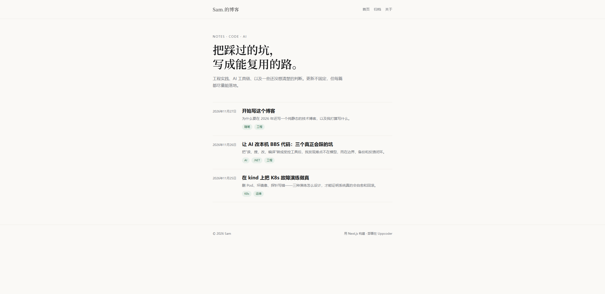

# Sam 的博客



一个用 Next.js 构建的静态博客：文章是仓库里的 Markdown，构建时生成页面，没有数据库和后台。

## 本地开发

```bash
npm install
npm run dev:hot    # 本地热更新开发，http://localhost:3000
npm run build      # 生产构建
npm run dev        # 生产模式（build + start；Uppcoder 等托管平台默认跑这个）
npm start          # 已有构建产物时的生产启动
```

需要 Node 20.9+，推荐 22。

## 写一篇新文章

在 `content/` 下新建 `my-post.md`：

```markdown
---
title: 文章标题
date: 2026-12-01
summary: 一句话摘要，会显示在列表里
tags: [工程, AI]
---

正文用 Markdown 写。
```

文件名就是 URL：`/posts/my-post`。文件名只允许小写字母、数字和连字符。

## 目录结构

```
app/               页面（App Router）
  page.tsx         首页
  posts/[slug]/    文章详情
  archive/         归档
  about/           关于
content/           Markdown 文章
lib/posts.ts       读取与渲染文章
.github/workflows/ CI（npm ci + next build）
```

## CI

推送到 `main` 会触发 GitHub Actions：`npm ci` → `npm run build`。构建失败会在 Actions 页标红，不会影响线上。

## 部署到 Uppcoder

1. 在 Uppcoder 打开 **Deploy an app**。
2. 选 **Blank stack**，框架选 `Next.js`（或直接用 `Next.js` 模板）。
3. Build 步骤填：
   - Repository: `https://github.com/sam-zhang-414/sam-blog`（或 SSH 地址）
   - Branch: `main`
   - Build command: `npm ci && npm run build`
   - Start command: `npm start`
   - Node 版本：22（若面板有该选项）
4. 环境变量：一般不需要；如平台注入 `PORT`，`next start` 会自动读取。
5. 点 **Deploy**，拿到平台分配的域名后绑定自定义域名即可。
6. 如果 Build 页有 **Auto deploy / Webhook**，打开它，之后 `git push` 即自动重建；没有就 push 后手动点 Redeploy。

> Uppcoder 的 Next.js 模板默认执行 `npm run dev`。本仓库把 `dev` 定义为 `next build && next start`，所以线上跑的是生产构建；本地热更新请用 `npm run dev:hot`。如果以后平台开放命令配置，直接改成 Build `npm ci && npm run build`、Start `npm start`。

## 发布流程

```bash
git add content/my-post.md
git commit -m "post: my-post"
git push
```

CI 通过后，在 Uppcoder 重新部署（或等待自动部署）。
